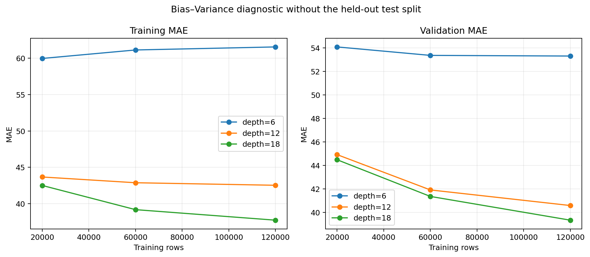

# Random Forest Bias–Variance 점검

## 분석 원칙

- 학습 구간과 공식 검증 구간만 사용
- 보관 시험 구간은 사용하지 않음
- 학습 표본은 고정 난수 42의 중첩 표본으로 구성
- 같은 검증 표본에서 학습량과 `max_depth`에 따른 오차 비교
- 이 분석은 설명용 진단이며 이미 확정한 최종 모델을 다시 선택하지 않음

## 결과

| max_depth | 학습 행 | 검증 행 | 학습 MAE | 검증 MAE | MAE 차이 | 검증 WAPE | 검증 RMSE |
|---:|---:|---:|---:|---:|---:|---:|---:|
| 6 | 20,000 | 30,000 | 59.97 | 54.09 | -5.89 | 9.27% | 103.73 |
| 6 | 60,000 | 30,000 | 61.14 | 53.37 | -7.77 | 9.15% | 101.08 |
| 6 | 120,000 | 30,000 | 61.56 | 53.31 | -8.25 | 9.14% | 99.79 |
| 12 | 20,000 | 30,000 | 43.67 | 44.92 | 1.25 | 7.70% | 93.20 |
| 12 | 60,000 | 30,000 | 42.88 | 41.91 | -0.97 | 7.19% | 89.52 |
| 12 | 120,000 | 30,000 | 42.53 | 40.59 | -1.94 | 6.96% | 86.29 |
| 18 | 20,000 | 30,000 | 42.50 | 44.48 | 1.98 | 7.63% | 94.04 |
| 18 | 60,000 | 30,000 | 39.18 | 41.36 | 2.18 | 7.09% | 88.80 |
| 18 | 120,000 | 30,000 | 37.73 | 39.34 | 1.61 | 6.75% | 84.40 |

## 해석

학습 MAE와 검증 MAE가 함께 높으면 모델이 패턴을 충분히 학습하지 못한 높은 Bias 상태로 본다. 학습 MAE는 낮지만 검증 MAE와의 차이가 커지면 학습 표본에 지나치게 맞춘 높은 Variance 가능성을 의심한다.

시간순 학습·검증 구간의 교통량 분포와 난이도가 다르므로 일부 설정에서는 검증 MAE가 학습 MAE보다 낮을 수 있다. 따라서 오차 차이의 부호 하나만으로 과적합을 판단하지 않고 학습량 증가에 따른 검증 오차 추세를 함께 본다.

가장 큰 학습 표본에서 검증 MAE가 가장 낮은 진단 설정은 `max_depth=18`이며 검증 MAE는 39.34대, 학습·검증 MAE 차이는 1.61대다. 이 값은 진단용 표본 결과이므로 최종 모델의 공식 검증·시험 성능을 대체하지 않는다.
