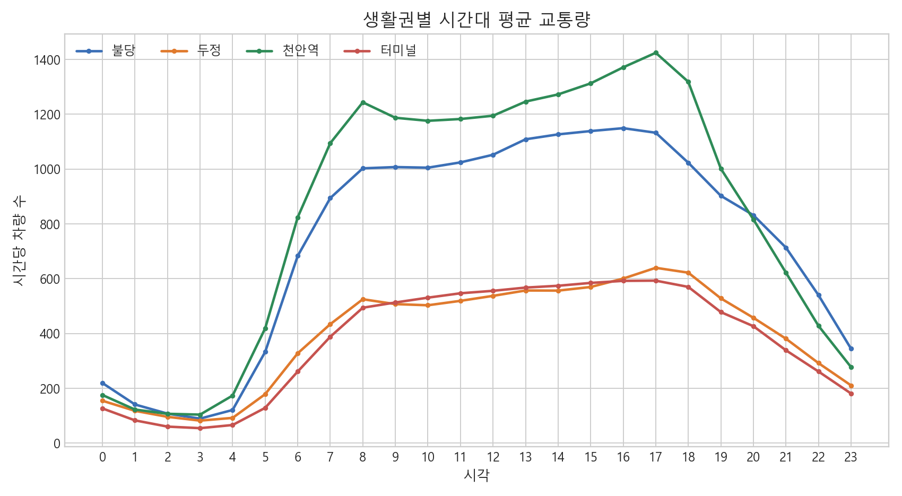
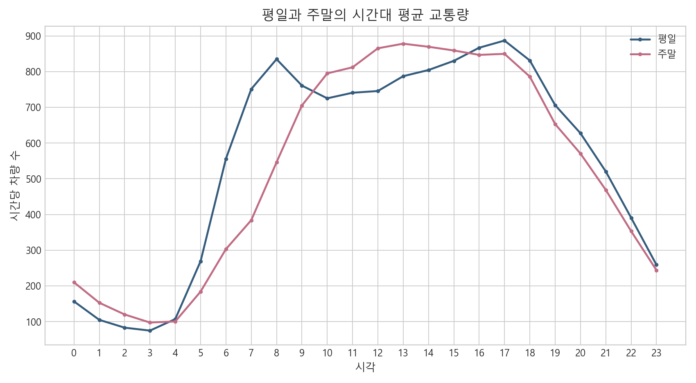
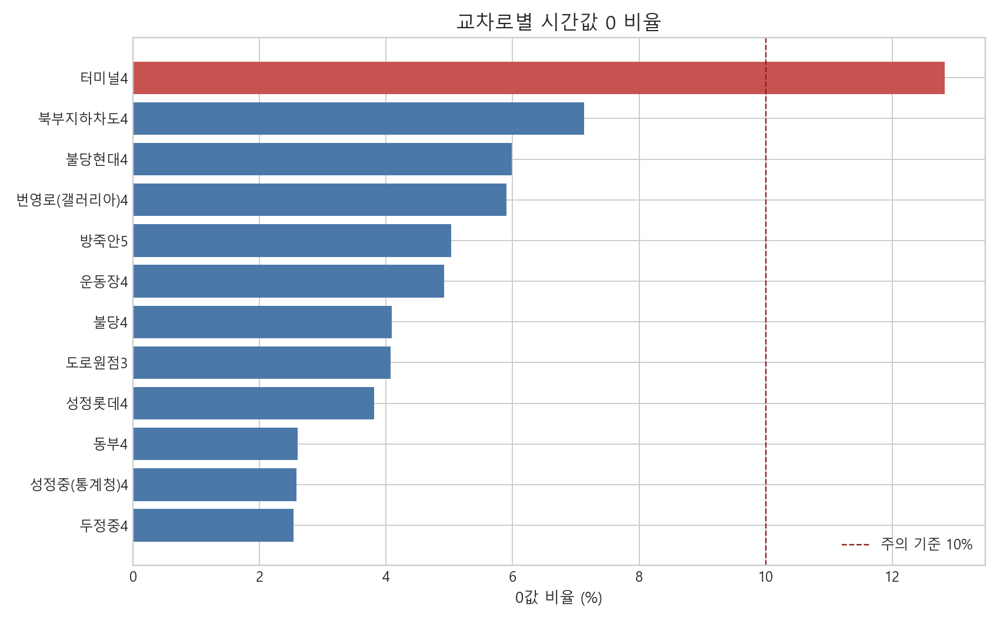
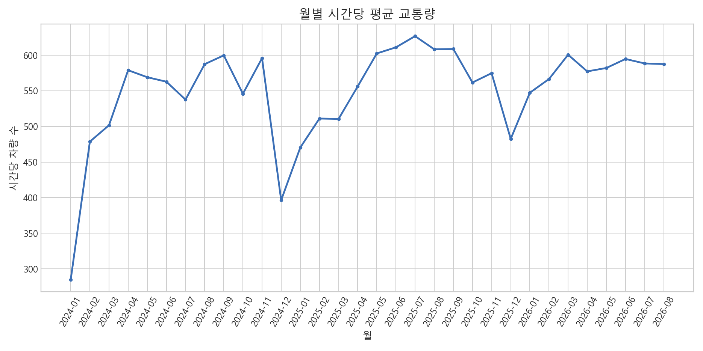

# 선정 교차로 EDA 결과

## 데이터 범위

- 기간: 2024-01-01~2026-08-31
- 시간별 행: 1,028,544개
- 교차로: 12개
- 접근로 조합: 44개
- 평균 교통량: 550.1대/시간
- 중앙값 교통량: 334.0대/시간
- 0값: 54,193개, 전체의 5.3%
- 24시간 전체가 0인 접근로·날짜: 1,277건

## 고교통량 기준 확인

고교통량 기준은 학습 기간인 2024년 1월부터 2025년 12월까지만 사용해 접근로별 90백분위수로 계산한다. 접근로별 기준값의 최솟값은 143.0대, 중앙값은 838.5대, 최댓값은 2669.0대이다. 하나의 공통 차량 수를 모든 접근로에 적용하지 않는다.

## 품질 판단

- 중복 키, 교통량 결측값과 음수 교통량은 없다.
- 단일 0값은 실제 저교통량일 수 있으므로 자동 삭제하지 않는다.
- 24시간 전체가 0인 접근로·날짜는 센서 중단 가능성이 있어 모델 학습 대상에서 제외할 품질 플래그로 사용한다.
- 0값 비율이 10% 이상인 교차로: 터미널4 12.8%
- `터미널4`는 생활권 대표성 때문에 유지하되, 모델 성능을 교차로별로 따로 보고한다.

## 주요 관찰

- 생활권별 평균 교통량의 최고 시간대: 두정 17시(639.9대), 불당 16시(1149.4대), 천안역 17시(1424.5대), 터미널 17시(593.0대)
- 평일과 주말의 최고 시간대: 주말 13시(878.1대), 평일 17시(886.9대)
- 월별 시간당 평균은 2024-01 285.0대로 가장 낮고 2025-07 626.7대로 가장 높다. 월별 차이의 원인은 이 자료만으로 단정하지 않고 이후 월별 오차 분석 대상으로 둔다.

## 생성 그림

### 생활권별 시간대 평균

### 평일·주말 시간대 비교

### 교차로별 0값 비율

### 월별 시간당 평균

## 다음 단계

품질 플래그를 반영한 입력 변수 생성 코드를 작성한다. 시간·요일·공휴일, 과거 1·2·24·168시간 교통량과 최근 3·6시간 평균은 현재 시점 이전의 값만 사용한다. 모델 학습 전에 학습·검증·시험 기간을 시간순으로 분리한다.
