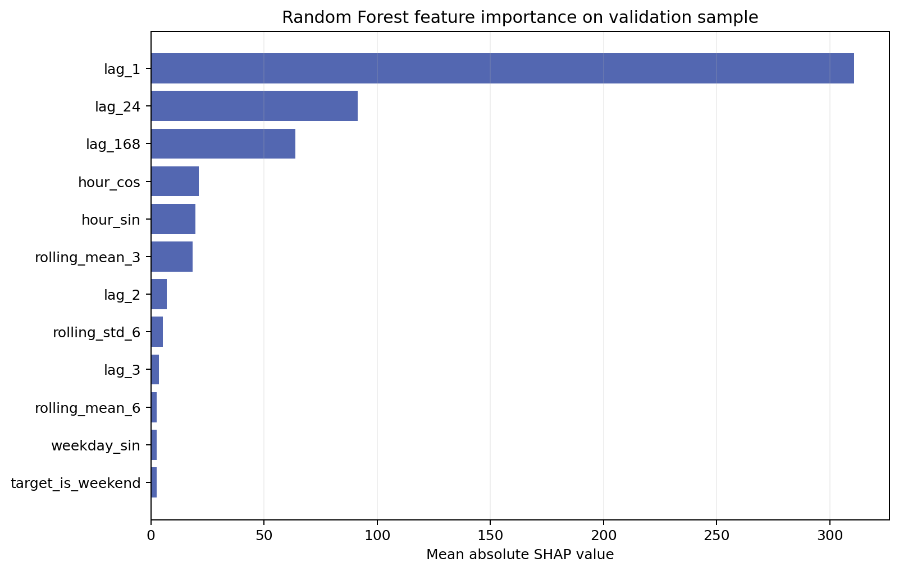

# Random Forest SHAP 입력 변수 분석

## 분석 조건

- 대상 모델: 최종 Random Forest
- 사용 구간: 검증 구간만 사용
- 분석 표본: 2,000행, 고정 난수 42
- 보관 시험 구간: 사용하지 않음

## 주요 영향 변수

| 순위 | 설명 | 입력 열 | 평균 절대 SHAP | 비중 |
|---:|---|---|---:|---:|
| 1 | 1시간 전 교통량 | `lag_1` | 310.69 | 56.0% |
| 2 | 전날 같은 시각 교통량 | `lag_24` | 91.51 | 16.5% |
| 3 | 전주 같은 시각 교통량 | `lag_168` | 63.81 | 11.5% |
| 4 | 예측 시각(cos) | `hour_cos` | 21.29 | 3.8% |
| 5 | 예측 시각(sin) | `hour_sin` | 19.82 | 3.6% |
| 6 | 최근 3시간 평균 | `rolling_mean_3` | 18.55 | 3.3% |
| 7 | 2시간 전 교통량 | `lag_2` | 7.01 | 1.3% |
| 8 | 최근 6시간 변동성 | `rolling_std_6` | 5.31 | 1.0% |
| 9 | 3시간 전 교통량 | `lag_3` | 3.61 | 0.7% |
| 10 | 최근 6시간 평균 | `rolling_mean_6` | 2.65 | 0.5% |
| 11 | 요일(sin) | `weekday_sin` | 2.61 | 0.5% |
| 12 | 주말 여부 | `target_is_weekend` | 2.61 | 0.5% |

## 읽는 방법

평균 절대 SHAP이 클수록 해당 변수가 여러 검증 행의 예측값을 크게 움직였다는 뜻이다. 예를 들어 `lag_1`이 상위라면 직전 시간 교통량이 1시간 후 교통량 예측에 많이 사용됐다는 의미다.

이 값은 모델 내부의 예측 기여도이지 원인과 결과를 증명하지 않는다. 또한 절댓값 평균이므로 교통량을 올렸는지 내렸는지는 이 표만으로 판단하지 않는다.
